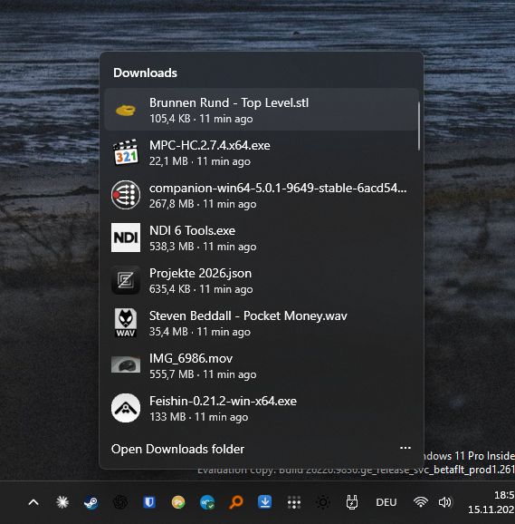
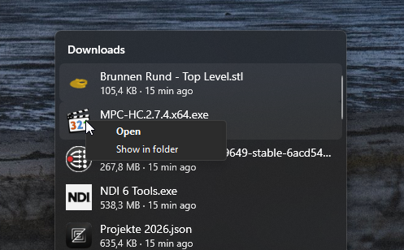
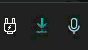
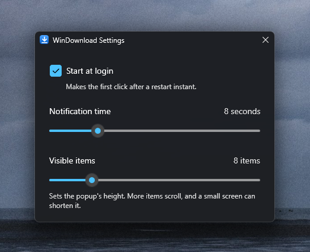

# Downloads in Tray

A Windows 11 alternative to the macOS Dock Downloads stack. Click the pinned taskbar icon to see your recent downloads, newest first, and click one to open it.



## Install

Run `DownloadsInTray-<version>-setup.exe`. It needs the [.NET 10 Desktop Runtime](https://dotnet.microsoft.com/download/dotnet/10.0); if that's missing, setup offers the download page. It installs for your account only, with no admin prompt, adds a Start menu entry, and offers to start the app with Windows. Windows doesn't let apps pin themselves, so then open Start, search for Downloads in Tray, right-click it and choose **Pin to taskbar**.

An earlier install under the old name WinDownload is replaced, and its settings carry over. Pin the new icon and unpin the old one, which no longer works.

## Use

- **Click the icon** to open or close the popup. Clicking elsewhere or pressing Esc also closes it.
- **Click a row** to open the item, or right-click it for **Show in folder**. Arrow keys and Enter work too.

  

- **Running downloads** from Chrome, Edge and Firefox appear at the top with a moving bar, the size so far and the speed. A download that stops growing for 5 seconds shows as paused. If you watched a download here, the popup comes back without taking focus when it finishes, with the file marked, and closes again after the notification time unless you hover or click it. Browsers don't record the final size in their unfinished files, so there's no percentage.
- **Drag a row** into a folder or app. Explorer moves it within a drive and copies it across drives.
- **Notification:** a small notice fades in above the tray when something new lands in Downloads, and clicking it opens the file (or the list, when several arrived together). Right-click it for **Open**, **Show in folder** and **Show all downloads**. Drag it into a folder or app to move all the files it announces. It stays quiet while the popup is open and when Windows reports that you shouldn't be interrupted, such as during full-screen apps.
- **Tray icon:** it shows the app is running. Left-click toggles the popup. Right-click opens a menu with Show downloads, Open Downloads folder, Settings and Quit. Windows may hide it under the tray's ^ arrow until you drag it out; the app tells you once with a notification. While a download is running, the icon's arrow slides down into the tray:

  
- **⋯ menu:** **Settings** covers Start at login, which makes the first click after a reboot instant, how long notifications stay up (2 to 30 seconds), how many items the popup shows before scrolling (3 to 30), which sets its height, and a monochrome tray icon that's white on a dark taskbar and black on a light one. **Quit Downloads in Tray** stops the background process.

  

## How it works

A pinned icon can only launch an exe. The first launch stays running with a hidden popup, and each later launch signals it and exits. While none of its windows are showing, it lets Windows throttle it to save power (EcoQoS), and it runs at full speed again as soon as something opens.

The app icon is drawn in `src\DownloadsInTray\Assets\icon.svg`. After changing it, regenerate the .ico with `powershell -File tools\build-icon.ps1`. The "Downloads" heading in the popup uses Windows' own Downloads folder icon, loaded from `imageres.dll` at runtime instead of shipped with the app.

The list shows files and folders from the Downloads known folder, sorted by creation time and capped at 50. Hidden and system items and unfinished downloads (`.crdownload`, `.part`, `.partial`, `.download`, `.tmp`) are left out.

## Uninstall

Unpin the icon, then uninstall Downloads in Tray from **Settings \> Apps \> Installed apps**. That also removes its settings and the start-at-login entry.

## Build

Requires the .NET 10 SDK.

```
./build-release.ps1
```

This puts the release files in `dist\`:

| File | Size | Needs |
| --- | --- | --- |
| `DownloadsInTray-<version>-setup.exe` | about 2 MB | the .NET 10 Desktop Runtime; setup checks for it and offers the download |
| `DownloadsInTray-<version>-win-x64.exe` | about 0.3 MB | the [.NET 10 Desktop Runtime](https://dotnet.microsoft.com/download/dotnet/10.0) |
| `DownloadsInTray-<version>-win-x64-self-contained.exe` | about 70 MB | nothing, the runtime is bundled |

It also builds `DownloadsInTray-<version>-x64.msix` for the Microsoft Store. Before uploading, fill in the three identity values from Partner Center in `installer\msix\store-identity.json`. The Store signs the package. In the Store version, start at login is a Windows startup task that you manage under Settings > Apps > Startup.

The setup is only built when [Inno Setup 6](https://jrsoftware.org/isinfo.php) is installed (`winget install JRSoftware.InnoSetup --scope user`). Both exes also run on their own from any folder.

The names and version come from `src\DownloadsInTray\DownloadsInTray.csproj`: `<Product>` is the display name, `<AssemblyName>` the file name, and `<Version>` the version.

For a quick install while developing, `./install.ps1` publishes to `%LOCALAPPDATA%\Programs\DownloadsInTray` and adds a Start menu shortcut, without the setup.

## Disclaimer

Claude Code was used creating this app. I kept the code small and (hopefully) efficient and I had a look on it to ensure it does not contain bullshit.
